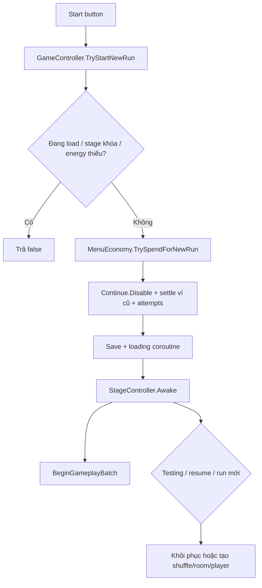

# DATA FLOW — Nguồn dữ liệu và các đường ghi

Ngày: **30/10/2026**. Báo cáo đọc tĩnh; không thay đổi dữ liệu. Xem phạm vi tại [SYSTEM_OVERVIEW.md](SYSTEM_OVERVIEW.md).

## 1. Nguồn dữ liệu chính

Không có một `PlayerData` duy nhất chứa mọi trạng thái. Source hiện chia thành **nội dung cấu hình**, **tiến trình lâu dài**, **trạng thái run** và **view trình bày**.

| Miền | Cấu hình gốc | Trạng thái có thẩm quyền trong bộ nhớ | View/cache không phải kho gốc | Bằng chứng |
| --- | --- | --- | --- | --- |
| Hero/loadout | ArmoryDatabase, HeroData/HeroLevel, ItemData/ItemLevel | ArmorySave: HeroSaveData và ItemSaveData; ArmoryManager giữ cache selected hero/equipped item | HeroCard/ItemCard, preview model, text tên/cấp | [ArmoryManager.InitItems](../../Assets/The%20Archer/Scripts/Armory/ArmoryManager.cs#L59), [ArmoryManager.InitHeroes](../../Assets/The%20Archer/Scripts/Armory/ArmoryManager.cs#L215) |
| Player combat | HeroLevel + ItemLevel + upgrade/ability behavior | PlayerStatsHandler và modifier; HP thực tế nằm trong HealthbarBehavior mà PlayerBehavior đọc | Healthbar visual, text damage/stat | [PlayerBehavior.Awake](../../Assets/The%20Archer/Scripts/Player/PlayerBehavior.cs#L103), [PlayerStatsHandler.Init](../../Assets/The%20Archer/Scripts/Player/PlayerStatsHandler.cs#L115), [PlayerBehavior.SaveHP](../../Assets/The%20Archer/Scripts/Player/PlayerBehavior.cs#L134) |
| Inventory gear | ArmoryDatabase | ArmorySave.Items, capacity và pending equipment | ArmoryDashboard.visibleItems/cells; grid/pool | [ArmorySave](../../Assets/The%20Archer/Scripts/Armory/ArmorySave.cs#L9), [ArmoryDashboard.Refresh](../../Assets/The%20Archer/Scripts/UI/Armory/ArmoryDashboard.cs#L167) |
| Mảnh/nguyên liệu | ItemData.Crafting + CraftingDatabase | CraftingInventorySave đếm theo key; EquipmentCrafting thao tác | InventoryStack do dashboard dựng để trình bày | [EquipmentCrafting.GetQuote](../../Assets/The%20Archer/Scripts/Crafting/EquipmentCrafting.cs#L34), [CraftingInventorySave](../../Assets/The%20Archer/Scripts/Crafting/CraftingInventorySave.cs#L9) |
| Currency | CurrenciesDatabase, Price, MenuEconomySettings | CurrencySave riêng cho mỗi ID và loại ví | MenuWalletView/CostButton/text; ResultCurrencies là bản chụp | [CurrenciesManager.Start](../../Assets/The%20Archer/Scripts/Toolkit/Currency/CurrenciesManager.cs#L28), [DropManager.GrantPickedUpItems](../../Assets/The%20Archer/Scripts/Drop/DropManager.cs#L73) |
| Permanent upgrade | UpgradesDatabase/UpgradeData/level | UpgradesSave lưu level; UpgradeData có event, behavior runtime áp stat | UpgradeDashboardPage, UpgradeCardBehavior, stat preview | [UpgradesManager.IncrementUpgradeLevel](../../Assets/The%20Archer/Scripts/Upgrades/UpgradesManager.cs#L77) |
| Stage tiến trình | StageDatabase/StageData | StageSave: selected index, trạng thái theo StageId, attempts, testing/drop history | Stage selector, preview | [StageSave](../../Assets/The%20Archer/Scripts/Stage/StageSave.cs#L10) |
| Run đang dở | StageData và thứ tự shuffle | ContinuePlayingSave + AbilitiesSave + ví gameplay + BossChestSave receipt theo runToken | Player/Room/selector đọc và ghi từng phần | [ContinuePlayingSave](../../Assets/The%20Archer/Scripts/Stage/ContinuePlayingSave.cs#L6), [AbilitiesManager.Awake](../../Assets/The%20Archer/Scripts/Abilities/Data/AbilitiesManager.cs#L20) |
| Quest/achievement | DailyQuestsDatabase, AchievementsDatabase | DailyQuestsSave, AchievementsSave; manager giữ index/summary | Row pool, badge, progress fill | [DailyQuestsManager.Initialize](../../Assets/The%20Archer/Scripts/Quests/DailyQuestsManager.cs#L19), [AchievementsManager.Initialize](../../Assets/The%20Archer/Scripts/Achievements/AchievementsManager.cs#L34) |
| Phần thưởng ngẫu nhiên | LuckyRewardTable, BossChestRewards hoặc EnemyDropData override | LuckyRewardsSave và BossChestSave lưu receipt/claim flags | Wheel slice, prize list, popup kết quả | [LuckyRewardsService.TryPurchase](../../Assets/The%20Archer/Scripts/Lucky%20Rewards/LuckyRewardsService.cs#L64), [BossChestService.PrepareFromDrops](../../Assets/The%20Archer/Scripts/Lucky%20Rewards/BossChestService.cs#L41) |
| Ngôn ngữ | MenuTranslations trong Resources | LanguageSave, static MenuLanguage | LocalizedMenuScope lưu bản text/font nguồn | [MenuLanguage.Initialize](../../Assets/The%20Archer/Scripts/Localization/MenuTranslations.cs#L66), [LocalizedMenuScope.Bind](../../Assets/The%20Archer/Scripts/UI/Main%20Menu/LocalizedMenuScope.cs#L13) |

`SaveManager.GetSave<T>` trả **object mutable trong cache**, không phải bản sao chỉ đọc. `SaveDatabase.GetSave<T>` tạo cell hoặc trả object hiện có. Vì vậy nhiều script lấy cùng khóa có thể sửa cùng một state. [SaveManager.GetSave](../../Assets/The%20Archer/Scripts/Toolkit/Save/SaveManager.cs#L77), [SaveDatabase.GetSave](../../Assets/The%20Archer/Scripts/Toolkit/Save/SaveDatabase.cs#L39), [SaveCell](../../Assets/The%20Archer/Scripts/Toolkit/Save/SaveCell.cs#L6).

## 2. Kho lưu và khóa

| Khóa yêu cầu qua GetSave | Kiểu / chủ sở hữu nghiệp vụ |
| --- | --- |
| `Stage` | StageSave; GameController/StageController và stage menu |
| `Continue Playing` | ContinuePlayingSave; Player, Room, XP, shuffle, drop, selector, stage/result/pause |
| `Abilities Save` | AbilitiesSave; AbilitiesManager |
| `Armory` | ArmorySave; ArmoryManager, Bag, Forge, Crafting và popup |
| `Upgrades Save` | UpgradesSave; UpgradesManager |
| `Crafting Inventory` | CraftingInventorySave; EquipmentCrafting qua CraftingManager |
| `Daily Quests` | DailyQuestsSave; DailyQuestsManager |
| `Achievements` | AchievementsSave; AchievementsManager |
| `Lucky Rewards` | LuckyRewardsSave; LuckyRewardsService |
| `Boss Chests` | BossChestSave; BossChestService |
| `Energy Recovery` | EnergyRecoverySave; MenuEconomyService |
| `Language Settings` | LanguageSave; MenuLanguage |
| `gold` / `gem` / `energy` | Ví lâu dài CurrencySave; lấy từ ID cấu hình, không phải enum hardcoded trong save layer |
| `<currencyId>:___GAMEPLAY___` | Ví tạm CurrencySave của run |
| `Audio`, `Input`, `Vibration` | Preference save của manager tương ứng |

Các key có thể tra tại constructor/Initialize trong các class trên; currency keys được tạo tại [CurrenciesManager.Start](../../Assets/The%20Archer/Scripts/Toolkit/Currency/CurrenciesManager.cs#L28). Trong SaveManager/SaveDatabase, key chuỗi được chuyển bằng `GetHashCode()` thành hash số; cell lưu hash + serialized data. Đây không phải cơ chế account ID/server ID. [SaveManager.GetSave](../../Assets/The%20Archer/Scripts/Toolkit/Save/SaveManager.cs#L77), [SaveDatabase.GetSave](../../Assets/The%20Archer/Scripts/Toolkit/Save/SaveDatabase.cs#L39).

### Dữ liệu trên đĩa

- Nhánh Unity `6000.6` dùng JSON; mỗi cell có dữ liệu JSON và database bao ngoài. JSON ở đây là serialization, **không tự đồng nghĩa mã hóa bảo mật**. SerializationHelper có helper Encrypt khi truyền secureKey; các lời gọi SaveManager đang khảo sát không truyền khóa này.
- Nhánh file dùng `Application.persistentDataPath`, tên Editor `game_save_editor`, player `game_save`. Không suy đoán đường tuyệt đối trên máy người chơi vì phụ thuộc môi trường/product settings.
- Source còn có PlayerPrefs và WebGL localStorage; `saveType` quyết định nhánh. Có nhánh binary cho Unity cũ, không phải nhánh chính của Unity hiện tại.
- `SaveDatabase.Flush` yêu cầu các save object đẩy runtime list/counter sang field serialize. File không phải nguồn được đọc lại sau mỗi thao tác UI.

Nguồn: [SaveManager.LoadSave](../../Assets/The%20Archer/Scripts/Toolkit/Save/SaveManager.cs#L139), [SaveManager.Save](../../Assets/The%20Archer/Scripts/Toolkit/Save/SaveManager.cs#L42), [SaveManager.ForceSave](../../Assets/The%20Archer/Scripts/Toolkit/Save/SaveManager.cs#L276), [SaveDatabase.Flush](../../Assets/The%20Archer/Scripts/Toolkit/Save/SaveDatabase.cs#L27), [SerializationHelper](../../Assets/The%20Archer/Scripts/Toolkit/Save/SerializationHelper.cs#L12).

## 3. Từ loadout đến player trong run

1. `ArmoryManager.Start` tải `Armory`, khởi tạo list, kiểm tra item/hero/level, dựng cache loadout, tạo các service phụ.
2. `StageController.Awake` chọn stage và instantiate player prefab.
3. `PlayerBehavior.Awake` lấy hero/weapon từ Armory, gắn mapping animation, khởi tạo Stats.
4. `PlayerStatsHandler.Init` cộng HP/damage hero với gear; movement/attack speed/damage-received multiplier được nhân; crit chance/HP recovery được cộng. Sau đó các upgrade/ability behavior tiếp tục thêm modifier.
5. HP trong trận được sao vào ContinuePlayingSave bằng `SaveHP`; XP/XPLevel được ExperienceManager ghi vào ContinuePlayingSave.

Nguồn: [ArmoryManager.Start](../../Assets/The%20Archer/Scripts/Armory/ArmoryManager.cs#L36), [StageController.Awake](../../Assets/The%20Archer/Scripts/Stage/StageController.cs#L119), [PlayerBehavior.Awake](../../Assets/The%20Archer/Scripts/Player/PlayerBehavior.cs#L103), [PlayerStatsHandler.Init](../../Assets/The%20Archer/Scripts/Player/PlayerStatsHandler.cs#L115), [ExperienceManager.Init](../../Assets/The%20Archer/Scripts/Experience/ExperienceManager.cs#L36).

Menu có **hai phép trình bày stat khác nhau**: `ArmoryHeroPanel.RecalculateStats` chỉ tổng HP/damage hero+gear; `ArmoryStatsSnapshot.Calculate` thêm projection permanent upgrades bằng switch riêng. Gameplay áp upgrade behavior thực tế. Vì vậy chênh lệch giữa text compact/menu/combat không tự chứng minh Save sai. [ArmoryHeroPanel.RecalculateStats](../../Assets/The%20Archer/Scripts/UI/Armory/ArmoryHeroPanel.cs#L157), [ArmoryStatsSnapshot.Calculate](../../Assets/The%20Archer/Scripts/UI/Armory/ArmoryStatsSnapshot.cs#L17), [UpgradesManager.OnStageLoaded](../../Assets/The%20Archer/Scripts/Upgrades/UpgradesManager.cs#L37).

## 4. Bắt đầu run và resume

`LoadStage()` còn là entry cho resume/testing và không tự lặp thao tác chi energy của `TryStartNewRun`. Trong `MainMenuStagesPageBehavior.InitSaves`, run cũ được nhớ StageContentId trước khi menu reset selected index về 0. Phải phân biệt **index đang xem** với **content ID run dở**. [GameController.TryStartNewRun](../../Assets/The%20Archer/Scripts/Other/GameController.cs#L201), [GameController.LoadStage](../../Assets/The%20Archer/Scripts/Other/GameController.cs#L218), [MainMenuStagesPageBehavior.InitSaves](../../Assets/The%20Archer/Scripts/UI/Main%20Menu/MainMenuStagesPageBehavior.cs#L75), [StageController.InitStageFromUnfinishedSession](../../Assets/The%20Archer/Scripts/Stage/StageController.cs#L174).

MenuEconomyService giữ hồi phục/cap và hạn mua ngày; mỗi StageData cung cấp chi phí start. `DeveloperToolsSettings` hiện điều khiển quyền mở công cụ, không có bằng chứng là công tắc online/offline toàn game. [MenuEconomyService.Refresh](../../Assets/The%20Archer/Scripts/Toolkit/Currency/MenuEconomyService.cs#L69), [MenuEconomyService.Buy](../../Assets/The%20Archer/Scripts/Toolkit/Currency/MenuEconomyService.cs#L109), [MenuEconomySettings](../../Assets/The%20Archer/Scripts/Toolkit/Currency/MenuEconomySettings.cs#L6), [DeveloperToolsSettings](../../Assets/The%20Archer/Scripts/Development/DeveloperToolsSettings.cs#L7).

## 5. XP, ability và wave

Enemy/XP drop và wave không có enemy có thể cấp XP. ExperienceManager tăng XPLevel và phát `onXpLevelChanged`; AbilitySelector nhận event rồi dùng AbilitiesManager lấy lựa chọn, add/increase behavior và ghi AbilitiesSave. `IsAbilityAvailable` chặn skill max thông thường, nhưng cho `IsRepeatedAbility`; Endgame là fallback riêng. Không phải mọi skill max đều bị cấm tuyệt đối. [RoomBehavior.EndWave](../../Assets/The%20Archer/Scripts/Stage/Room/RoomBehavior.cs#L212), [ExperienceManager.IncreaseLevel](../../Assets/The%20Archer/Scripts/Experience/ExperienceManager.cs#L126), [AbilitySelectorBehavior.OnXpLevelChanged](../../Assets/The%20Archer/Scripts/UI/Abilities/AbilitySelectorBehavior.cs#L154), [AbilitiesManager.IsAbilityAvailable](../../Assets/The%20Archer/Scripts/Abilities/Data/AbilitiesManager.cs#L224), [AbilitiesManager.GetAbilitiesForSelector](../../Assets/The%20Archer/Scripts/Abilities/Data/AbilitiesManager.cs#L157).

Room chờ loot được nhặt, item indicator biến mất và ability selector đóng trước bước tiếp. Đây là state gameplay phụ thuộc callback UI, không chỉ hiệu ứng hiển thị. [RoomBehavior.EndWave](../../Assets/The%20Archer/Scripts/Stage/Room/RoomBehavior.cs#L212).

## 6. Boss loot và quyết toán run

### 6.1. Tạo rương và nhặt rương

`EnemyBehavior.Drop` bỏ qua Item/CraftingResource/BossChest ở vòng drop thường. Nếu là boss và chưa phát rương, nó xác định key theo run/stage/room/wave/enemy/spawn; ưu tiên pool item override của stage khi có, dùng `BossChestService.PrepareFromDrops`; nếu không dùng `BossChestRewards` từ override → EnemyData → config mặc định. Không có bước audit nào sửa rate boss. [EnemyBehavior.Drop](../../Assets/The%20Archer/Scripts/Enemy/EnemyBehavior.cs#L519).

`Prepare...` tạo receipt; `BossChestDropBehavior`/`BossChestService.Claim` đánh dấu đã nhặt, chưa đồng nghĩa gear đã vào Armory. `DropManager.OnDropPickedUp` tạo hoặc xếp hàng thông báo và ghi metric collect. [BossChestService.PrepareFromDrops](../../Assets/The%20Archer/Scripts/Lucky%20Rewards/BossChestService.cs#L41), [BossChestService.Claim](../../Assets/The%20Archer/Scripts/Lucky%20Rewards/BossChestService.cs#L70), [BossChestDropBehavior](../../Assets/The%20Archer/Scripts/Drop/Behaviors/BossChestDropBehavior.cs#L6), [DropManager.OnDropPickedUp](../../Assets/The%20Archer/Scripts/Drop/DropManager.cs#L162).

### 6.2. Khi chết, clear hoặc ForceFail

`StageController.FinalizeRunRewards` theo thứ tự:

1. Chặn lặp bằng `IsResultFinalized`/`settlingResult`.
2. `DropManager.GrantPickedUpItems`: chụp số tiền run, xử lý item legacy, commit receipt rương boss, gộp ResultItems.
3. `CurrenciesManager.ApplyGameplayAmounts`: chuyển ví run vào ví lâu dài rồi clear ví run.
4. Disable Continue, flush quest/achievement/crafting.
5. Đặt finalized, dọn panel gameplay, commit save batch.
6. Caller mở StageCompleteScreen hoặc StageFailedScreen, các screen đọc dữ liệu kết quả để tạo/bind reward card từ prefab.

Nguồn: [StageController.OnHeroDied](../../Assets/The%20Archer/Scripts/Stage/StageController.cs#L412), [StageController.OnExitReached](../../Assets/The%20Archer/Scripts/Stage/StageController.cs#L348), [StageController.ForceFail](../../Assets/The%20Archer/Scripts/Stage/StageController.cs#L428), [StageController.FinalizeRunRewards](../../Assets/The%20Archer/Scripts/Stage/StageController.cs#L437), [DropManager.GrantPickedUpItems](../../Assets/The%20Archer/Scripts/Drop/DropManager.cs#L73), [StageCompleteScreen.Show](../../Assets/The%20Archer/Scripts/UI/StageCompleteScreen.cs#L84), [StageFailedScreen.Show](../../Assets/The%20Archer/Scripts/UI/StageFailedScreen.cs#L85).

Guard trong bộ nhớ không phải transaction bền vững qua crash. Boss receipt có các cờ riêng và `RecoverPending` cho delivery đã yêu cầu quyết toán; không được suy ra mọi nhánh exception/crash đã được phục hồi hoàn toàn. [BossChestService.CommitRun](../../Assets/The%20Archer/Scripts/Lucky%20Rewards/BossChestService.cs#L81), [BossChestService.RecoverPending](../../Assets/The%20Archer/Scripts/Lucky%20Rewards/BossChestService.cs#L100).

### 6.3. Ghi trong RAM khác với ghi file

`BeginGameplayBatch` khiến `Save(false/true)` thông thường return khi đang run. Các setter/progress vẫn cập nhật **RAM**. `CommitGameplayBatch` tắt defer và Save. Tuy nhiên `ForceSave` không kiểm tra defer, được gọi khi destroy và mất focus ở player; autosave gọi Save(true) nên vẫn chịu defer; ForceSave là ngoại lệ quan trọng. Do đó không mô tả hệ hiện tại là “chỉ ghi file duy nhất lúc kết thúc” hoặc “mỗi setter Level đều ghi file”. [SaveManager.BeginGameplayBatch](../../Assets/The%20Archer/Scripts/Toolkit/Save/SaveManager.cs#L41), [SaveManager.Save](../../Assets/The%20Archer/Scripts/Toolkit/Save/SaveManager.cs#L42), [SaveManager.ForceSave](../../Assets/The%20Archer/Scripts/Toolkit/Save/SaveManager.cs#L276), [SaveManager.OnApplicationFocus](../../Assets/The%20Archer/Scripts/Toolkit/Save/SaveManager.cs#L393), [SaveManager.AutoSaveCoroutine](../../Assets/The%20Archer/Scripts/Toolkit/Save/SaveManager.cs#L351).

## 7. Inventory và các giao dịch menu

| Thao tác | Đường đi hiện tại | State bị ghi |
| --- | --- | --- |
| Gear mới / đồ trùng | Delivery hoặc DropManager → Armory.UnlockItem/IncreaseItemLevel | ItemSaveData; queue nếu túi đầy; metric achievement |
| Mở rộng túi | Dashboard → Bag.TryExpand(expectedCapacity) → ví.TryWithdrawAndCommit → capacity + claim pending | ArmorySave + CurrencySave |
| Nâng gear | ExpandedItemPopup → EquipmentForge.TryUpgrade(id, expectedLevel) | CurrencySave + ItemSaveData.Level + event metric |
| Ghép gear | ForgePage → EquipmentCrafting.TryCraft | Trừ mảnh/nguyên liệu, AddItem, callback Armory.UnlockItem, Save |
| Nâng permanent mới | UpgradeDashboardPage → PermanentUpgradeService.TryBuy | Ví + UpgradesSave + UpgradeData event + achievement |
| Nâng permanent cũ | UpgradeCardBehavior.OnUpgradeButtonClicked → Withdraw rồi IncrementUpgradeLevel | Cùng dữ liệu trên, nhưng bypass service mới |
| Mở/nâng hero | ExpandedHeroPopup.OnUpgradeButtonClicked sửa IsUnlocked hoặc Level rồi Withdraw | HeroSaveData + ví; không qua EquipmentForge/PermanentUpgradeService |
| Chọn gear/hero | ExpandedItemPopup/ExpandedHeroPopup sửa IsEquipped; Armory listener sửa các slot/hero khác | ArmorySave + cache ArmoryManager |
| Nhận quest | DailyQuestsManager.Grant: đánh dấu nhận rồi Deposit | DailyQuestsSave + ví |
| Nhận achievement | AchievementsManager.TryClaim: đánh dấu rồi Deposit, flush trong finally | AchievementsSave + ví |
| Wheel/chest menu | LuckyRewardsService.TryPurchase → receipt + Delivery.Grant → Acknowledge sau khi xem | LuckyRewardsSave + ví/Armory/Crafting |

Nguồn: [ArmoryManager.UnlockItem](../../Assets/The%20Archer/Scripts/Armory/ArmoryManager.cs#L295), [InventoryBagService.TryExpand](../../Assets/The%20Archer/Scripts/Armory/InventoryBagService.cs#L29), [EquipmentForge.TryUpgrade](../../Assets/The%20Archer/Scripts/Armory/EquipmentForge.cs#L60), [EquipmentCrafting.TryCraft](../../Assets/The%20Archer/Scripts/Crafting/EquipmentCrafting.cs#L49), [PermanentUpgradeService.TryBuy](../../Assets/The%20Archer/Scripts/Upgrades/PermanentUpgradeService.cs#L28), [UpgradeCardBehavior.OnUpgradeButtonClicked](../../Assets/The%20Archer/Scripts/UI/Main%20Menu/Upgrades/UpgradeCardBehavior.cs#L221), [ExpandedHeroPopup.OnUpgradeButtonClicked](../../Assets/The%20Archer/Scripts/UI/Armory/Hero/ExpandedHeroPopup.cs#L239), [DailyQuestsManager.Grant](../../Assets/The%20Archer/Scripts/Quests/DailyQuestsManager.cs#L88), [AchievementsManager.TryClaim](../../Assets/The%20Archer/Scripts/Achievements/AchievementsManager.cs#L104), [LuckyRewardsService.TryPurchase](../../Assets/The%20Archer/Scripts/Lucky%20Rewards/LuckyRewardsService.cs#L64).

Gear hiện lưu một entry theo item ID; bản trùng tăng level, không phải các instance gear có ID riêng. `UsedSlots` dựa trên số gear entry; fragment/material stack không trừ gear capacity. Dashboard tính thêm các stack và ô trống cho mục đích hiển thị. Không lấy số cell nhìn thấy làm số slot gear đang dùng. [ArmorySave](../../Assets/The%20Archer/Scripts/Armory/ArmorySave.cs#L9), [ArmoryDashboard.Refresh](../../Assets/The%20Archer/Scripts/UI/Armory/ArmoryDashboard.cs#L167), [ArmoryDashboard.RenderCells](../../Assets/The%20Archer/Scripts/UI/Armory/ArmoryDashboard.cs#L232).

## 8. Một dữ liệu có nhiều writer

| Dữ liệu | Các writer đã thấy | Quyền sở hữu hiện tại / nguy cơ |
| --- | --- | --- |
| ItemSaveData.Level | EquipmentForge.TryUpgrade; ArmoryManager.IncreaseItemLevel; khởi tạo/clamp InitItems | Setter phát event ngay, không chỉ serialize; đường mua và thưởng phải thống nhất max/metric |
| HeroSaveData.Level/IsUnlocked/IsEquipped | Armory.InitHeroes; ExpandedHeroPopup; Armory.OnHeroSelectedEventFired sửa hero khác | UI có quyền nghiệp vụ trực tiếp; setter Level còn ghi quest/achievement |
| UpgradesSave level | UpgradesManager.Awake áp DevStartLevel; IncrementUpgradeLevel được gọi từ service mới và UI cũ | Service mới chưa là cổng bắt buộc cho mọi writer |
| CurrencySave.amount | Drop reward, wave reward, quests, achievements, menu economy, forge/crafting liên quan, lucky delivery, developer grant, ApplyGameplayAmounts | Manager chỉ cung cấp ví; caller có thể Deposit/Withdraw trực tiếp |
| ContinuePlayingSave | StageController, RoomBehavior, PlayerBehavior, ExperienceManager, RoomsShuffler, DropManager, AbilitySelector; UI tiếp tục/thất bại | Có phân chia theo field nhưng chưa có aggregate kiểm tra toàn run trước commit |
| StageSave | Stage menu unlock/select/purchase; GameController attempts; StageController complete; DropManager history | UI và gameplay cùng ghi tiến trình |
| Stat player | Init hero+gear; permanent upgrade; ability; status; revive/hurry/heal | Nhiều writer là chủ đích; đúng sai phụ thuộc thêm/gỡ modifier và lifetime |
| Dock/Time.timeScale | Nhiều popup/screen và EasingManager | State toàn cục, chưa thể hiện cơ chế acquire/release lồng nhau thống nhất |

Nguồn cho các field setter và side effect: [ItemSaveData](../../Assets/The%20Archer/Scripts/Armory/ItemSaveData.cs#L7), [HeroSaveData](../../Assets/The%20Archer/Scripts/Armory/HeroSaveData.cs#L7), [UpgradesManager.Awake](../../Assets/The%20Archer/Scripts/Upgrades/UpgradesManager.cs#L14), [ContinuePlayingSave](../../Assets/The%20Archer/Scripts/Stage/ContinuePlayingSave.cs#L6), [StageSave](../../Assets/The%20Archer/Scripts/Stage/StageSave.cs#L10), [CurrencySave](../../Assets/The%20Archer/Scripts/Toolkit/Currency/CurrencySave.cs#L8). Các đường UI/pause cụ thể được liệt kê trong [UI_RUNTIME_OWNERSHIP.md](UI_RUNTIME_OWNERSHIP.md).

## 9. Danh tính và tương thích

ID item/hero/stage, enum type, level index, key save và GUID Unity là các loại danh tính khác nhau. Đổi tên asset không cho phép tự đổi ID trong save; thay thứ tự stage có thể ảnh hưởng selected index/shuffle; thay số level cần đọc/clamp save cũ. Source đã có một số clamp tại Armory và StageContentId cho resume, nhưng không thể suy ra mọi truy cập index đều được bảo vệ. [ArmoryManager.InitItems](../../Assets/The%20Archer/Scripts/Armory/ArmoryManager.cs#L59), [ArmoryManager.InitHeroes](../../Assets/The%20Archer/Scripts/Armory/ArmoryManager.cs#L215), [RoomsShuffler.Load](../../Assets/The%20Archer/Scripts/Stage/RoomsShuffler.cs#L159), [ContinuePlayingSave.RememberStage](../../Assets/The%20Archer/Scripts/Stage/ContinuePlayingSave.cs#L12).

Đề xuất sau audit: lập contract từng thao tác ghi và kiểm thử dữ liệu cũ trước khi thay schema/đưa lên server. Không có migration hay server nào được tạo trong tác vụ này.
