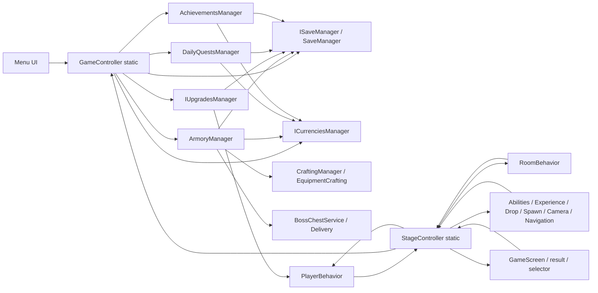
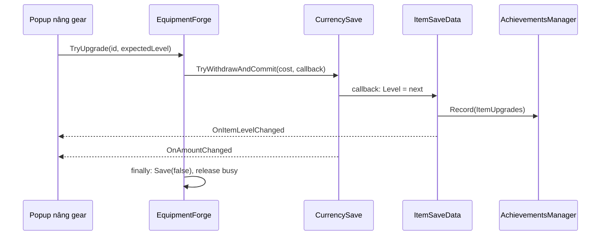

# DEPENDENCY MAP — Quan hệ phụ thuộc

Ngày: **30/10/2026**. Phạm vi/giới hạn: [SYSTEM_OVERVIEW.md](SYSTEM_OVERVIEW.md). Mũi tên `A → B` nghĩa là A gọi/đọc/đăng ký với B, không tự chứng minh quan hệ sở hữu bộ nhớ.

## 1. Đồ thị tổng thể

Đồ thị trên rút từ `Register...` và các call site trong [GameController](../../Assets/The%20Archer/Scripts/Other/GameController.cs#L17), [StageController](../../Assets/The%20Archer/Scripts/Stage/StageController.cs#L17), [ArmoryManager.Start](../../Assets/The%20Archer/Scripts/Armory/ArmoryManager.cs#L36), [RoomBehavior.EndWave](../../Assets/The%20Archer/Scripts/Stage/Room/RoomBehavior.cs#L212), [GameScreenBehavior](../../Assets/The%20Archer/Scripts/UI/GameScreenBehavior.cs#L11). Đây là đồ thị ở cấp subsystem, không phải mọi call C#.

## 2. Đăng ký, khởi tạo và tuổi thọ

| Giai đoạn | Đăng ký / hành động | Hợp đồng ngầm cần giữ |
| --- | --- | --- |
| Bắt đầu Play/subsystem | `GameController.ResetStatics`, `StageController.ResetStatics`, `EasingManager.ResetStatics` xóa static | Đây là reset khi subsystem đăng ký, không tự tương đương cleanup ở mọi lần chuyển scene |
| Main Menu `Awake` | GameController và SaveManager có execution order `-100`; GameController singleton + DontDestroyOnLoad, SaveManager tải database; các manager đăng ký | Không suy ra thứ tự giữa hai component cùng order. Source khởi tạo SaveManager không cần GameController.Start |
| Manager `Awake` | Armory/Input/Audio/Vibration/Upgrades gọi `GameController.Register...`; Upgrades đọc save trong Awake | GameController.SaveManager phải sẵn sàng trước các nơi đọc |
| Main Menu `Start` | `GameController.Start` tạo quests/achievements; `CurrenciesManager` order `-5` tạo ví và economy; `ArmoryManager.Start` tạo Bag/Forge/Crafting/BossChests | Menu tương tác cần Armory/wallet/manager đã initialize; gọi constructor không đồng nghĩa mọi manager đã Start |
| Vào Game | `StageController.Awake` order `-10`: mở save batch, chọn dữ liệu run, tạo player | Game scene phụ thuộc bootstrap Main Menu; mở Game trực tiếp không cung cấp các dịch vụ lâu dài |
| Game `Awake/Start` | Manager run đăng ký; `RegisterExperienceManager` gọi `Init`; `RegisterAbilitiesManager` gọi `Init` trong Start; `StageController.Start` dựng room và áp upgrades | Không gom mọi đăng ký thành Awake. Phải đọc đúng phase khi dùng Player/Room/Abilities |
| Room sẵn sàng | `StageController.DoAfterRoomLoaded` chạy callback sau room load | Callback phụ thuộc scene phải sống đến lúc thực thi; danh sách không cung cấp token hủy riêng cho từng subscriber |
| Kết thúc run | `FinalizeRunRewards`; sau nút về menu, `ReturnToMainMenu` gọi Upgrades.OnStageUnloaded và LoadMainMenu | Không bỏ qua quyết toán hoặc cleanup upgrade khi đổi luồng điều hướng |

Nguồn: [GameController.ResetStatics](../../Assets/The%20Archer/Scripts/Other/GameController.cs#L43), [GameController.Start](../../Assets/The%20Archer/Scripts/Other/GameController.cs#L143), [CurrenciesManager.Start](../../Assets/The%20Archer/Scripts/Toolkit/Currency/CurrenciesManager.cs#L28), [ArmoryManager.Start](../../Assets/The%20Archer/Scripts/Armory/ArmoryManager.cs#L36), [StageController.Awake](../../Assets/The%20Archer/Scripts/Stage/StageController.cs#L119), [StageController.RegisterExperienceManager](../../Assets/The%20Archer/Scripts/Stage/StageController.cs#L313), [StageController.RegisterAbilitiesManager](../../Assets/The%20Archer/Scripts/Stage/StageController.cs#L340), [StageController.DoAfterRoomLoaded](../../Assets/The%20Archer/Scripts/Stage/StageController.cs#L72), [StageController.ReturnToMainMenu](../../Assets/The%20Archer/Scripts/Stage/StageController.cs#L468).

`GameController.Register...` phần lớn chặn đăng ký trùng; `RegisterMainMenuScreenBehavior` cho thay reference screen sau khi tải scene menu mới. Các setter đăng ký trong StageController chủ yếu gán static. Do đó không coi mọi manager có cùng chính sách duplicate/lifetime. [GameController.RegisterMainMenuScreenBehavior](../../Assets/The%20Archer/Scripts/Other/GameController.cs#L135), [StageController.RegisterRoom](../../Assets/The%20Archer/Scripts/Stage/StageController.cs#L330).

## 3. Các cạnh phụ thuộc quan trọng

| Bên gọi → bên được dùng | Đường gọi có bằng chứng | Ý nghĩa khi thay đổi |
| --- | --- | --- |
| UI stage → GameController → Economy/StageSave/Save | [MainMenuStagesPageBehavior.OnPlayerButtonClicked](../../Assets/The%20Archer/Scripts/UI/Main%20Menu/MainMenuStagesPageBehavior.cs#L425); [GameController.TryStartNewRun](../../Assets/The%20Archer/Scripts/Other/GameController.cs#L201) | Nút start không chỉ tải scene; còn energy, attempts, Continue và lưu |
| StageController → concrete SaveManager | `Awake`/`FinalizeRunRewards` downcast từ ISaveManager để Begin/CommitGameplayBatch | Thay implementation ISaveManager hiện có thể làm mất batching mà vẫn compile |
| Player → Armory → model/weapon/mapping | [PlayerBehavior.Awake](../../Assets/The%20Archer/Scripts/Player/PlayerBehavior.cs#L103), [ArmoryManager.SpawnHero](../../Assets/The%20Archer/Scripts/Armory/ArmoryManager.cs#L421), [ArmoryManager.GetWeaponAnimationsSet](../../Assets/The%20Archer/Scripts/Armory/ArmoryManager.cs#L450) | Thêm hero cần data + weapon mapping + prefab/Animator, không chỉ model |
| Stats → Armory; UI snapshot → Stats + Upgrades | [PlayerStatsHandler.Init](../../Assets/The%20Archer/Scripts/Player/PlayerStatsHandler.cs#L115), [ArmoryStatsSnapshot.Calculate](../../Assets/The%20Archer/Scripts/UI/Armory/ArmoryStatsSnapshot.cs#L17) | Menu và combat có phần công thức chung, nhưng permanent-upgrade projection còn được viết lại trong UI |
| ItemSave/HeroSave → Quests/Achievements | [ItemSaveData](../../Assets/The%20Archer/Scripts/Armory/ItemSaveData.cs#L7), [HeroSaveData](../../Assets/The%20Archer/Scripts/Armory/HeroSaveData.cs#L7) | DTO save có side effect gameplay; đổi Level khi migration/testing cũng có thể phát metric |
| Upgrades → Player + UI qua UpgradeData event | [UpgradesManager.OnStageLoaded](../../Assets/The%20Archer/Scripts/Upgrades/UpgradesManager.cs#L37), [UpgradesManager.IncrementUpgradeLevel](../../Assets/The%20Archer/Scripts/Upgrades/UpgradesManager.cs#L77) | Data asset vừa cấu hình vừa là publisher sự kiện; listener cần cleanup |
| Room → gameplay UI để quyết định chuyển wave | [RoomBehavior.EndWave](../../Assets/The%20Archer/Scripts/Stage/Room/RoomBehavior.cs#L212) chờ loot/text/ability đóng | Lỗi một panel hoặc notification có thể làm gameplay không chuyển wave |
| Enemy → Armory.BossChests → Drop → UI → Armory | [EnemyBehavior.Drop](../../Assets/The%20Archer/Scripts/Enemy/EnemyBehavior.cs#L519), [DropManager.OnDropPickedUp](../../Assets/The%20Archer/Scripts/Drop/DropManager.cs#L162), [DropManager.GrantPickedUpItems](../../Assets/The%20Archer/Scripts/Drop/DropManager.cs#L73) | Combat gọi cả reward service lâu dài; boss rate và settlement phải thay đồng bộ |
| Currency → mọi UI quan sát | [CurrencySave.Deposit](../../Assets/The%20Archer/Scripts/Toolkit/Currency/CurrencySave.cs#L23), [CurrencySave.TryWithdrawAndCommit](../../Assets/The%20Archer/Scripts/Toolkit/Currency/CurrencySave.cs#L54) | Event đồng bộ trong thao tác tiền; exception UI có thể truyền ngược vào giao dịch |
| Quest → wallet → Quest UI/Achievement UI | [DailyQuestsManager.Grant](../../Assets/The%20Archer/Scripts/Quests/DailyQuestsManager.cs#L88), [DailyQuestsPageBehavior.Start](../../Assets/The%20Archer/Scripts/UI/Main%20Menu/Quests/DailyQuestsPageBehavior.cs#L58), [AchievementsPageBehavior.Start](../../Assets/The%20Archer/Scripts/UI/Main%20Menu/Achievements/AchievementsPageBehavior.cs#L77) | Claim thưởng có thể đánh thức page đang ẩn; page ẩn không mặc định đã unsubscribe |
| MenuLanguage → TMP; data-binding UI → cùng TMP | [LocalizedMenuScope.Bind](../../Assets/The%20Archer/Scripts/UI/Main%20Menu/LocalizedMenuScope.cs#L13), [LocalizedMenuScope.Apply](../../Assets/The%20Archer/Scripts/UI/Main%20Menu/LocalizedMenuScope.cs#L21) | Hai writer có thể nối tiếp nhau trước render; text tiếng Anh còn là khóa dịch |
| Responsive profile → Rect/TMP/visibility; page/animation → cùng thuộc tính | [Placement.Apply](../../Assets/The%20Archer/Scripts/UI/ResponsiveMenuLayout.cs#L16), [MainMenuPageBehavior.MoveCenter](../../Assets/The%20Archer/Scripts/UI/Main%20Menu/MainMenuPageBehavior.cs#L68) | Prefab không phải writer cuối của mọi thuộc tính lúc Play |

## 4. Các vòng phụ thuộc

### 4.1. Manager đăng ký và caller static

`ArmoryManager.Awake → GameController.RegisterArmoryManager`, sau đó `GameController.Start → ArmorySave/achievement restore`; gameplay/UI lại `GameController.ArmoryManager...`. Đây là coupling hai chiều qua service locator, dù không có vòng constructor trực tiếp. Tương tự StageController ↔ Room/Player/manager run.

**Rủi ro suy luận:** lỗi bootstrap/null/order tại một điểm có phạm vi lan rộng. Không thể kiểm thử một page riêng chỉ bằng instantiate page nếu chưa cung cấp các static dependency. Nguồn: [ArmoryManager.Awake](../../Assets/The%20Archer/Scripts/Armory/ArmoryManager.cs#L27), [GameController.Start](../../Assets/The%20Archer/Scripts/Other/GameController.cs#L143), [RoomBehavior.Awake](../../Assets/The%20Archer/Scripts/Stage/Room/RoomBehavior.cs#L43).

### 4.2. Save → nghiệp vụ → save → UI

Nguồn: [ExpandedItemPopup.OnUpgradeButtonClicked](../../Assets/The%20Archer/Scripts/UI/Armory/Items/ExpandedItemPopup.cs#L226), [EquipmentForge.TryUpgrade](../../Assets/The%20Archer/Scripts/Armory/EquipmentForge.cs#L60), setter `ItemSaveData.Level`, [CurrencySave.TryWithdrawAndCommit](../../Assets/The%20Archer/Scripts/Toolkit/Currency/CurrencySave.cs#L54). Callback event chạy ngay trong cùng call stack; không phải message queue tách biệt.

### 4.3. Kết quả trận đấu phụ thuộc UI

`OnHeroDied/OnExitReached → FinalizeRunRewards → GameScreen.PrepareForResult → SaveManager.CommitGameplayBatch → result Show`. Cờ `IsResultFinalized` được gán trước PrepareForResult/ghi file. Rủi ro khi một bước sau cờ ném exception được phân tích tại R04 trong [TECHNICAL_RISKS.md](TECHNICAL_RISKS.md). Không khẳng định đã xảy ra mất thưởng. [StageController.FinalizeRunRewards](../../Assets/The%20Archer/Scripts/Stage/StageController.cs#L437).

## 5. Phụ thuộc dữ liệu và asset

| Đầu vào | Người tiêu thụ | Kiểu liên kết |
| --- | --- | --- |
| StageDatabase → StageData → RoomData → WaveData | StageController, RoomsShuffler, RoomBehavior, EnemiesSpawner | Reference asset + dữ liệu nhúng, không phải mỗi wave một scene |
| ArmoryDatabase → ItemData/HeroData/WeaponAnimationSets | ArmoryManager, Player, inventory/menu | ID nội dung lưu trong save; GUID/fileID Unity giữ reference asset |
| UpgradesDatabase/AbilitiesDatabase | Manager tương ứng, UI card, behavior prefab | Enum type + level index + prefab + event trên data |
| Resources databases/settings | Crafting, Quests, Achievements, Economy và UI | Tên Resources path là dependency ẩn so với Inspector field |
| Prefab serialized reference/list | Page/controller/row pool | Thay số row/stat/reference có thể ảnh hưởng vòng lặp code |
| Layer/tag/animation event | Detector/projectile/navigation/weapon/enemy | Tên và event phải khớp dữ liệu import/Animator; compiler không kiểm tra đầy đủ |

Điểm đọc: [StageController.Awake](../../Assets/The%20Archer/Scripts/Stage/StageController.cs#L119), [RoomBehavior.LoadWave](../../Assets/The%20Archer/Scripts/Stage/Room/RoomBehavior.cs#L136), [ArmoryManager.Start](../../Assets/The%20Archer/Scripts/Armory/ArmoryManager.cs#L36), [AbilitiesManager.Init](../../Assets/The%20Archer/Scripts/Abilities/Data/AbilitiesManager.cs#L38), [GameController.InitializeMenuEconomy](../../Assets/The%20Archer/Scripts/Other/GameController.cs#L196), [PlayerBehavior.Awake](../../Assets/The%20Archer/Scripts/Player/PlayerBehavior.cs#L103).

## 6. Ranh giới để xử lý sau — chưa triển khai

1. Chốt chủ sở hữu từng thuộc tính UI và từng thao tác ghi dữ liệu trước khi tách class.
2. Chuẩn hóa đường giao dịch qua service hiện có; kiểm kê các đường UI cũ còn bypass trước khi xóa bất kỳ đường nào.
3. Làm rõ contract save batch/settlement và lifecycle/pause/dock; sau đó mới giảm phụ thuộc static.
4. Nếu cần online về sau: đặt authentication/player/inventory/economy/run-result API bên ngoài UI, nhưng giữ offline adapter riêng. `ISaveManager` hiện tại không đủ thay thế transaction/validation server.
5. Chỉ cân nhắc assembly boundary khi contract đã rõ. Không đề xuất đổi cả kiến trúc trong một lần sửa UI.

Đây là thứ tự giảm rủi ro, không phải thay đổi đã thực hiện.
