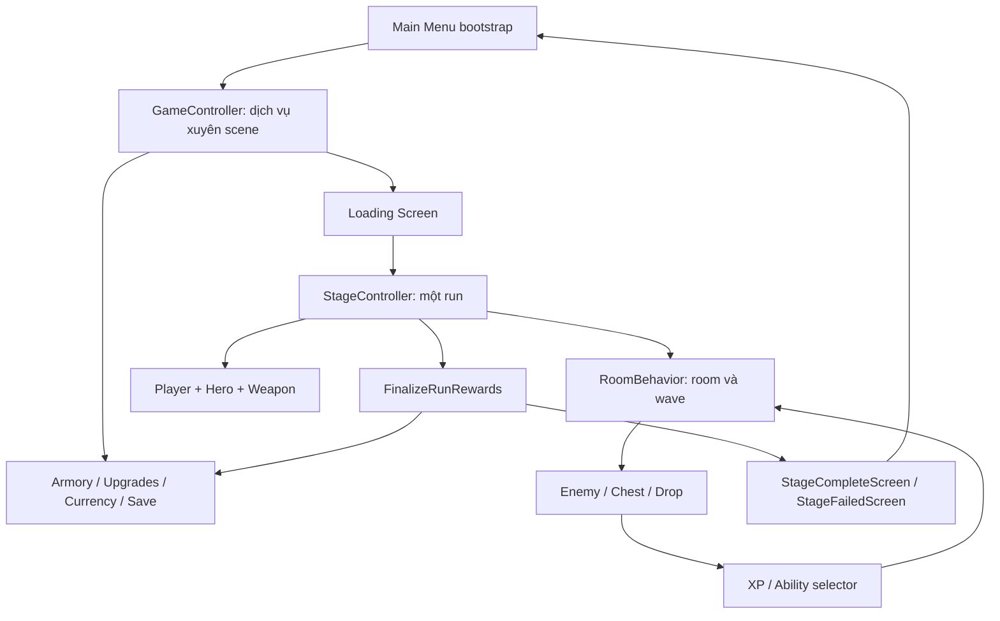

# SYSTEM OVERVIEW — Archer Roguelike

Ngày audit: **30/10/2026**. Commit nền: `b4529da3c82a54c79a2cbffe59bee9d14171f52e`.

## 1. Phạm vi và cách đọc

Đây là báo cáo đọc tĩnh **checkout hiện tại**, gồm source trong `Assets/The Archer/Scripts`, package/settings, dữ liệu đăng ký và reference YAML của ba scene chính. Không chạy Play Mode, test hoặc build; không sửa source, scene, prefab, ScriptableObject hay save người chơi. Chỉ tạo năm tài liệu trong thư mục này.

- **Quan sát:** có lệnh, cấu trúc hoặc reference cụ thể trong file được dẫn.
- **Rủi ro:** suy luận có điều kiện từ quan sát; chưa phải lỗi đã tái hiện.
- **Đề xuất:** công việc có thể thực hiện sau, chưa triển khai.

Các đường dẫn source trong bảng được liên kết về repository. `#L...` chỉ dòng tại thời điểm audit; class/method vẫn là đầu mối chính khi số dòng thay đổi. Một file tồn tại không chứng minh component đó đang active. Reference scene được đọc tĩnh, chưa mở rộng toàn bộ override của mọi prefab trong Editor.

Các tài liệu liên quan:

| Tài liệu | Nội dung |
| --- | --- |
| [DEPENDENCY_MAP.md](DEPENDENCY_MAP.md) | Phụ thuộc, vòng đời và điểm nối chéo |
| [DATA_FLOW.md](DATA_FLOW.md) | Nguồn dữ liệu, nơi ghi, lưu và nhận thưởng |
| [UI_RUNTIME_OWNERSHIP.md](UI_RUNTIME_OWNERSHIP.md) | Script ghi UI khi chạy, event/panel, quyền chỉnh Inspector |
| [TECHNICAL_RISKS.md](TECHNICAL_RISKS.md) | Rủi ro có bằng chứng và thứ tự xử lý đề xuất |

## 2. Ảnh chụp hiện trạng

| Hạng mục | Kết quả đọc |
| --- | --- |
| Unity | `6000.6.2f1`, từ `ProjectSettings/ProjectVersion.txt` |
| Package | URP `17.6.0`, Input System `1.20.0`, Cinemachine `6.6.0`, AI Navigation `2.0.14`, uGUI `2.6.0`; từ `Packages/manifest.json` |
| Source | 635 file `.cs` trong Assets: 630 trong `The Archer/Scripts` và 5 file shader/asset demo bên ngoài; riêng Scripts có 530 file ngoài thư mục tên `Editor`, 93 file UI |
| Ranh giới assembly | Không tìm thấy `.asmdef`/`.asmref` trong `Assets`; thư mục module hiện chưa phải ranh giới assembly độc lập |
| Scene build | `Main Menu` → `Loading Screen` → `Game`, đều enabled trong `ProjectSettings/EditorBuildSettings.asset` |
| Database stage | 4 entry trong `Assets/The Archer/Scriptables/Stages/Stage Database.asset`, field `stages` |
| Database armory | 14 item, 1 hero trong `Assets/The Archer/Scriptables/Armory/Armory Database.asset`, field `items`/`heroes`; hero tham chiếu `Heroes/Hero Data 003.asset` |
| Currency | `gold`, `gem`, `energy` trong `Assets/The Archer/Scriptables/Currencies Database.asset` |

Các con số trên là entry đăng ký trong các asset đã đối chiếu, không phải giới hạn thiết kế và không phải tổng mọi model có trên đĩa. Main Menu tham chiếu ba database Armory/Upgrades/Currencies; Game tham chiếu Stage Database. Không dùng các yêu cầu phát triển trước đây trong chat để khẳng định tính năng đã có trong checkout này.

Không tìm thấy lớp backend/authentication/leaderboard hay client Socket.IO trong source gameplay đã khảo sát. `ISaveManager` hiện là abstraction lưu local, chưa phải dịch vụ tài khoản/server. Đây là giới hạn bằng chứng trong source dự án, không phải kiểm kê bảo mật mọi thư viện bên thứ ba. Xem [ISaveManager](../../Assets/The%20Archer/Scripts/Toolkit/Save/ISaveManager.cs#L3), [GameController](../../Assets/The%20Archer/Scripts/Other/GameController.cs#L17).

## 3. Ba tầng vận hành

`GameController` là service locator static, giữ instance `DontDestroyOnLoad`. `StageController` là đầu mối static cho run hiện tại. Phần lớn behavior gọi các đầu mối này trực tiếp; chưa có composition root/DI tách hoàn toàn. Bằng chứng: [GameController.Awake](../../Assets/The%20Archer/Scripts/Other/GameController.cs#L64), các `Register...`; [StageController.Awake](../../Assets/The%20Archer/Scripts/Stage/StageController.cs#L119), các `Register...`.

## 4. Manager, Controller và Service xuyên scene

Đường dẫn dưới đây tính từ `Assets/The Archer/Scripts/`. Các interface là hợp đồng; không phải manager thứ hai.

| Class / vị trí | Trách nhiệm và phương thức quan trọng | Dữ liệu/phụ thuộc chính |
| --- | --- | --- |
| [GameController](../../Assets/The%20Archer/Scripts/Other/GameController.cs#L17) | `Awake`, `Start`, `TryStartNewRun`, `LoadStage`, `LoadMainMenu`: đăng ký dịch vụ, khởi tạo quests/achievements, chuyển scene, khởi động giao dịch vào run | SceneSettings, Save, Currency, Armory, Upgrades, menu và StageController |
| [SaveManager](../../Assets/The%20Archer/Scripts/Toolkit/Save/SaveManager.cs#L14) / `ISaveManager` | `Awake`, `GetSave`, `Save`, `ForceSave`, `BeginGameplayBatch`, `CommitGameplayBatch`: tải cache save, serialize, ghi file/PlayerPrefs/WebGL, trì hoãn ghi trong run | SaveDatabase, SaveCell, SerializationHelper |
| [CurrenciesManager](../../Assets/The%20Archer/Scripts/Toolkit/Currency/CurrenciesManager.cs#L9) / `ICurrenciesManager` | `Start`, `GetCurrency`, `ApplyGameplayAmounts`, `EraseGameplayAmounts`: tạo ví lâu dài và ví run theo cùng ID | CurrenciesDatabase, CurrencySave, MenuEconomyService |
| [MenuEconomyService](../../Assets/The%20Archer/Scripts/Toolkit/Currency/MenuEconomyService.cs#L19) | `Refresh`, `TrySpendForNewRun`, `Buy`: hồi năng lượng, chi phí run, đổi gem lấy gold/energy, hạn mua ngày | MenuEconomySettings, EnergyRecoverySave, ba ví và đồng hồ UTC |
| [ArmoryManager](../../Assets/The%20Archer/Scripts/Armory/ArmoryManager.cs#L11) | `Start`, `InitItems`, `InitHeroes`, `UnlockItem`, `IncreaseItemLevel`, `SpawnHero`, `SpawnWeapon`: inventory gear, loadout, hero và mapping animation | ArmoryDatabase/ArmorySave; sở hữu Bag, Forge, Crafting, BossChests |
| [InventoryBagService](../../Assets/The%20Archer/Scripts/Armory/InventoryBagService.cs#L9) | `GetState`, `TryExpand`: quote và mua tăng capacity, giải phóng hàng chờ | ArmorySave, currency, callback claim pending, dashboard config |
| [EquipmentForge](../../Assets/The%20Archer/Scripts/Armory/EquipmentForge.cs#L24) | `GetQuote`, `TryUpgrade`: **nâng level gear đã có** bằng giá của ItemLevel | ArmorySave, ItemData, ICurrenciesManager, ISaveManager |
| [CraftingManager](../../Assets/The%20Archer/Scripts/Crafting/CraftingManager.cs#L8) | `Initialize`, `OnChanged`, `FlushPending`: adapter MonoBehaviour cho crafting và lưu thay đổi | CraftingDatabase, EquipmentCrafting |
| [EquipmentCrafting](../../Assets/The%20Archer/Scripts/Crafting/EquipmentCrafting.cs#L10) | `GetQuote`, `TryCraft`, `AddLoot`, `OnItemUnlocked`: **ghép gear mới**, kho mảnh/nguyên liệu và recipe | CraftingInventorySave, ArmorySave, ItemData.Crafting, callback Armory |
| [UpgradesManager](../../Assets/The%20Archer/Scripts/Upgrades/UpgradesManager.cs#L6) / `IUpgradesManager` | `Awake`, `IncrementUpgradeLevel`, `OnStageLoaded`, `OnStageUnloaded`: level nâng cấp lâu dài và behavior áp vào player trong run | UpgradesDatabase/UpgradesSave, StageController.Player, achievement |
| [PermanentUpgradeService](../../Assets/The%20Archer/Scripts/Upgrades/PermanentUpgradeService.cs#L8) | `Quote`, `TryBuy`: kiểm tra giá, max/stale level/busy cho đường mua dashboard mới | IUpgradesManager, ví, SaveManager |
| [DailyQuestsManager](../../Assets/The%20Archer/Scripts/Quests/DailyQuestsManager.cs#L8) | `RefreshDay`, `Record`, `TryClaimQuest`, `TryClaimMilestone`, `FlushPending`: reset ngày, tiến độ và nhận thưởng | DailyQuestsDatabase/Save, currency; `GameController.Start` tạo component |
| [AchievementsManager](../../Assets/The%20Archer/Scripts/Achievements/AchievementsManager.cs#L17) | `Record`, `RecordStageClear`, `RecordItemOwned`, `TryClaim`, `RestoreKnownProgress`: metric, mục tiêu, summary category và thưởng | AchievementsDatabase/Save, currency; được GameController tạo |
| [LuckyRewardsService](../../Assets/The%20Archer/Scripts/Lucky%20Rewards/LuckyRewardsService.cs#L44) | `State`, `TryPurchase`, `Acknowledge`: mua lượt theo table, receipt chưa xem, phát thưởng | LuckyRewardTable, LuckyRewardsSave, ILuckyRewardDelivery, ví/save |
| `LuckyRewardDelivery` | `Resolve`, `Grant`: kiểm tra/quy đổi và đưa phần thưởng vào ví, gear, queue, crafting | Xem file `Lucky Rewards/LuckyRewardDelivery.cs`; ArmoryManager, CurrenciesManager |
| [BossChestService](../../Assets/The%20Archer/Scripts/Lucky%20Rewards/BossChestService.cs#L23) | `Prepare`, `PrepareFromDrops`, `Claim`, `CommitRun`, `RecoverPending`: receipt rương boss gắn run, thu nhặt và quyết toán | BossChestSave, cấu hình boss/stage, delivery |
| [DeveloperGrantService](../../Assets/The%20Archer/Scripts/Development/DeveloperGrantService.cs#L9) | `GrantCurrency`, `GrantItem`: công cụ cấp thử qua delivery, không phải kho inventory riêng | DeveloperToolsSettings, ví, armory, save |
| [InputManager](../../Assets/The%20Archer/Scripts/Toolkit/Input/InputManager.cs#L8) / `IInputManager` | `Init`, `Update`, `GamepadDetection`, `RegisterJoystick`: chuyển keyboard/gamepad/UI joystick và đọc MovementValue | InputAsset/InputSave, HighlightsParentBehavior, joystick |
| [AudioManager](../../Assets/The%20Archer/Scripts/Toolkit/Audio/AudioManager.cs#L9) / `IAudioManager` | `PlayAudio`, `PlayMusic`, `PlayButtonClick`: pool AudioSource, cooldown/nhóm âm lượng, nhạc | AudioData/AudioSave, mixer, SaveManager |
| [VibrationManager](../../Assets/The%20Archer/Scripts/Toolkit/Vibration/VibrationManager.cs#L9) / `IVibrationManager` | `Start`, `Vibrate`: cấu hình và phát rung theo nền tảng | VibrationSave, Gamepad |
| [EasingManager](../../Assets/The%20Archer/Scripts/Toolkit/Easing/EasingManager.cs#L11) | `DoFloat`, `DoAfter`, `DoTimeScale`, `Update`: host coroutine/easing static | Target do caller cung cấp; thời gian scaled/unscaled |
| [PoolsManager](../../Assets/The%20Archer/Scripts/Toolkit/Pool/PoolsManager.cs#L6) | `Awake`, `GetPool`, `GetEntity`: registry pool tổng quát theo name/hash nếu component được dùng | PoolObject; tồn tại song song với pool riêng của các manager |

`Forge` có hai nghĩa trong source: `EquipmentForge` nâng level gear; trang Forge gọi `EquipmentCrafting` để tạo gear bằng mảnh/nguyên liệu. Chúng không phải cùng một giao dịch. Xem [ExpandedItemPopup.OnUpgradeButtonClicked](../../Assets/The%20Archer/Scripts/UI/Armory/Items/ExpandedItemPopup.cs#L226), [ForgePageBehavior.Refresh](../../Assets/The%20Archer/Scripts/UI/Main%20Menu/Forge/ForgePageBehavior.cs#L115).

## 5. Điều phối gameplay và các subsystem trong run

| Class | Trách nhiệm / điểm vào | Liên kết chính |
| --- | --- | --- |
| [StageController](../../Assets/The%20Archer/Scripts/Stage/StageController.cs#L17) | Chọn/khôi phục stage, tạo player, đăng ký manager, room transition, revive/fail/clear, `FinalizeRunRewards` | Tất cả subsystem run và dịch vụ GameController |
| [RoomBehavior](../../Assets/The%20Archer/Scripts/Stage/Room/RoomBehavior.cs#L12) | `Init`, `LoadWave`, `EndWave`, `SpawnAdditionalEnemy`, `OnEnemyDefeated`: wave, enemy sống, chest, ability/loot wait, exit | StageData/RoomData/WaveData, spawner, XP, drop, UI |
| [RoomBuilder](../../Assets/The%20Archer/Scripts/Stage/RoomBuilder.cs#L7) | `Init`, `GetPooledObject`, `ClearRoom`: tạo pool môi trường và áp transform | StageData/RoomData, PoolGameObject |
| [RoomsShuffler](../../Assets/The%20Archer/Scripts/Stage/RoomsShuffler.cs#L6) | `Shuffle`, `Save`, `Load`, `GetActiveWaveData`: thứ tự room/wave theo group và resume | ContinuePlayingSave, StageData |
| [EnemiesSpawner](../../Assets/The%20Archer/Scripts/Enemy/EnemiesSpawner.cs#L7) | `Init`, `GetEnemy`, `GetChest`: đăng ký pool enemy/chest/spawn point của stage | EnemiesDatabase, ChestsDatabase, StageData |
| [NavigationManager](../../Assets/The%20Archer/Scripts/Enemy/NavigationManager.cs#L5) → [NavmeshNavigationManager](../../Assets/The%20Archer/Scripts/Enemy/NavmeshNavigationManager.cs#L7) | `Recalculate`, `IsPositionAvailable`, `IsStraightPathAvailable`, `GetRandomPosition` | NavMesh/surface, geometry room |
| [CameraManager](../../Assets/The%20Archer/Scripts/CameraManager.cs#L7) | `Init`, `TeleportCamera`, `ValidatePosition`: camera và confinement theo room | Cinemachine, RoomData, player target |
| [PlayerBehavior](../../Assets/The%20Archer/Scripts/Player/PlayerBehavior.cs#L14) | `Awake`, `Update`, `TakeDamage`, `StartPlaying`, `TryToRevive`: player sống, HP/input/target, hero/weapon | Armory, PlayerStatsHandler, detector, healthbar, ContinuePlayingSave |
| [PlayerStatsHandler](../../Assets/The%20Archer/Scripts/Player/PlayerStatsHandler.cs#L8) | `Init`: tổng hợp stat hero + gear; modifier/child stat là trạng thái run | HeroLevel/ItemLevel; ability và permanent upgrade tiếp tục thay đổi |
| `HeroBehavior` / `WeaponBehavior` | Animator, gắn weapon, movement/attack events; weapon sinh đạn | `Player/Hero/HeroBehavior.cs`, `Armory/WeaponBehavior.cs`; mapping hero–weapon |
| [ProjectilesManager](../../Assets/The%20Archer/Scripts/Projectiles/ProjectilesManager.cs#L7) / `IProjectilesManager` | `RegisterProjectile`, `GetProjectile`: pool theo prefab; không tự cấp pool khi chưa đăng ký | AbstractProjectile/SimpleProjectile, IProjectileTarget |
| [ParticlesManager](../../Assets/The%20Archer/Scripts/Particles/ParticlesManager.cs#L7) | `RegisterParticle`, `GetParticle`: pool VFX theo prefab | ParticleSystem, callers gameplay |
| [DropManager](../../Assets/The%20Archer/Scripts/Drop/DropManager.cs#L13) | `Drop`, `DropBossChest`, `OnDropPickedUp`, `GrantPickedUpItems`: drop sống, thông báo, loot run và dữ liệu kết quả | ContinuePlayingSave, Armory/BossChests, ví gameplay, WorldSpaceText |
| [ExperienceManager](../../Assets/The%20Archer/Scripts/Experience/ExperienceManager.cs#L9) | `Init`, `AddXP`, `IncreaseLevel`: XP **trong run**, thanh XP và event chọn skill | ExperienceData, ContinuePlayingSave, ExperienceUI |
| [AbilitiesManager](../../Assets/The%20Archer/Scripts/Abilities/Data/AbilitiesManager.cs#L8) | `Init`, `IsAbilityAvailable`, `GetAbilitiesForSelector`, `AddAbility`, `IncreaseAbilityLevel`: lựa chọn/áp behavior skill | AbilitiesDatabase/Save, player, Armory, TestingDatabase |
| [EnemyStatusEffectsManager](../../Assets/The%20Archer/Scripts/Status%20Effects/EnemyStatusEffectsManager.cs#L7) | `RegisterStatusEffect<T>`: tìm/tạo và tái sử dụng effect theo EnemyType cùng tham số | Ignite/Freeze/Poison/Shock; StatusEffectsHandler của target |
| [PlayerOrbsManager](../../Assets/The%20Archer/Scripts/Player/PlayerOrbsManager.cs#L7) | `RegisterOrbs`, `RemoveOrbs`, `Update`: vị trí/vòng quay, damage orb | IOrbsAbility và Player |
| [PlayerSpiritsManager](../../Assets/The%20Archer/Scripts/Player/PlayerSpiritsManager.cs#L6) | `RegisterSpirit`, `RemoveSpirit`, `ResetPosition`: đội hình spirit đi theo | SpiritBehavior, player |
| [WorldSpaceTextManager](../../Assets/The%20Archer/Scripts/UI/Text%20Indicators/WorldSpaceTextManager.cs#L7) | `Init`, `SpawnText`: pool text damage/heal/item, chuyển world→UI | WorldSpaceIndicatorsDatabase, TextIndicatorBehavior |
| [ConsoleTimer](../../Assets/The%20Archer/Scripts/Other/ConsoleTimer.cs#L6) | `StartTimer`, `StopTimer`, `ReportSessionResult`, `ResetSession`: đo/log thời gian | RoomBehavior, StageController; không phải database ranking |

Combat sử dụng `IProjectileTarget` cho player/enemy, stat `AdditiveStat`/`MultiplicativeStat`, modifier `StatAdder`/`StatMultiplier`. Enemy defeat và animation-ended là hai thời điểm khác nhau: room nhận defeat, còn `EnemyBehavior.OnDefeatEndedEventFired` mới tắt GameObject. Pool bật object trước khi caller cấu hình lần dùng mới. Nguồn: [EnemyBehavior.OnDefeatEndedEventFired](../../Assets/The%20Archer/Scripts/Enemy/EnemyBehavior.cs#L450), [RoomBehavior.OnEnemyDefeated](../../Assets/The%20Archer/Scripts/Stage/Room/RoomBehavior.cs#L442), [PoolComponent.GetEntity](../../Assets/The%20Archer/Scripts/Toolkit/Pool/PoolComponent.cs#L43).

## 6. UI, cấu hình và công cụ Editor

| Nhóm | Điểm điều phối và trách nhiệm |
| --- | --- |
| Điều hướng menu | `MainMenuScreenBehavior` chọn page; `MainMenuDockBehavior` nhận tab/input; `MainMenuPageBehavior` di chuyển/alpha/Canvas/raycast. [MainMenuScreenBehavior.Awake](../../Assets/The%20Archer/Scripts/UI/Main%20Menu/MainMenuScreenBehavior.cs#L35), [MainMenuPageBehavior.PrepareInitialState](../../Assets/The%20Archer/Scripts/UI/Main%20Menu/MainMenuPageBehavior.cs#L23) |
| Stage | `MainMenuStagesPageBehavior`, `MainMenuStageSelector`, `ArmoryHeroPanel`; unlock/start/preview/slot. Stage menu reset selection về index 0 trong `InitSaves`, giữ content ID của run dở riêng. [MainMenuStagesPageBehavior.InitSaves](../../Assets/The%20Archer/Scripts/UI/Main%20Menu/MainMenuStagesPageBehavior.cs#L75) |
| Armory | `MainMenuArmoryPageBehavior` chọn dashboard mới hoặc grid cũ; `ArmoryDashboard` trình bày stat/inventory/stack/bag; popup gear/hero xử lý chọn và nâng cấp. [MainMenuArmoryPageBehavior.MoveCenter](../../Assets/The%20Archer/Scripts/UI/Armory/MainMenuArmoryPageBehavior.cs#L69) |
| Upgrades | `UpgradeDashboardPage` + `PermanentUpgradeService`; các lớp `MainMenuUpgradePageBehavior`, `UpgradeCardBehavior`, `ExpandedUpgradePopup` vẫn tồn tại như luồng cũ. Không mặc định tất cả đều active cùng lúc. [UpgradeDashboardPage.Start](../../Assets/The%20Archer/Scripts/UI/Main%20Menu/Upgrades/UpgradeDashboardPage.cs#L34) |
| Forge/Quests/Achievements | Các page behavior tương ứng bind database, manager, wallet và row/view đã serialize. [ForgePageBehavior.Start](../../Assets/The%20Archer/Scripts/UI/Main%20Menu/Forge/ForgePageBehavior.cs#L42), [DailyQuestsPageBehavior.Start](../../Assets/The%20Archer/Scripts/UI/Main%20Menu/Quests/DailyQuestsPageBehavior.cs#L58), [AchievementsPageBehavior.Start](../../Assets/The%20Archer/Scripts/UI/Main%20Menu/Achievements/AchievementsPageBehavior.cs#L77) |
| Reward/economy/developer | `StageLuckyRewards`, `LuckyRewardsPopup`, `MenuWalletView`, `MenuEconomyPanel`, `DeveloperToolsPanel`; mở popup/giao dịch qua dịch vụ, cập nhật presentation |
| Gameplay UI | `GameScreenBehavior` phối hợp pause, ability, chest, objective và hai result screen. [GameScreenBehavior.PrepareForResult](../../Assets/The%20Archer/Scripts/UI/GameScreenBehavior.cs#L80) |
| Responsive/localization | `SafeAreaManager`, `ResponsiveMenuSurface`, `ResponsiveMenuLayout`; `LocalizedMenuScope` + `MenuLanguage` dịch text/font. Chúng là runtime writer, không chỉ dữ liệu Inspector |

Main Menu scene tham chiếu prefab `Assets/The Archer/Prefabs/UI/Menu Pages/Responsive Menu Surface.prefab`. Game scene tham chiếu các prefab `Prefabs/UI/Game/Stage Complete.prefab`, `Stage Failed.prefab`, `Pause Menu.prefab`, `Joystick.prefab`, `Heal Chest UI.prefab`, `Evil Chest UI.prefab`, `Abilities Selector/Ability Selector.prefab`.

Database content nằm ở `Scriptables`; các cấu hình UI/crafting/quests/achievements/economy còn nằm trong `Assets/The Archer/Resources/`. Các class `*Data/*Level/*Database` mô tả nội dung; các `*Save` giữ tiến trình người chơi. Một số ScriptableObject còn phát event runtime, nên chưa phải toàn bộ là dữ liệu bất biến: [AbilityData.Upgrade](../../Assets/The%20Archer/Scripts/Abilities/Data/AbilityData.cs#L50), [UpgradeData.SetLevel](../../Assets/The%20Archer/Scripts/Upgrades/UpgradeData.cs#L45).

Các công cụ `Scripts/Editor` và các hàm `Build/Create...` có `#if UNITY_EDITOR` phục vụ authoring, không tự đồng nghĩa dựng UI runtime. Ví dụ [ArmoryDashboard.Build](../../Assets/The%20Archer/Scripts/UI/Armory/ArmoryDashboard.cs#L41) chỉ nằm trong nhánh Editor; `RenderCells` của chính class này vẫn sửa layout lúc chạy. Cần phân biệt hai loại trước khi xử lý quyền chỉnh prefab.

## 7. Giới hạn xác minh

Audit kiểm kê toàn bộ tên file/module và các điểm quản lý, sau đó đọc sâu những tuyến dữ liệu/vòng đời được dẫn. Không phải chứng minh mọi tổ hợp trong 173 file thuộc module Abilities hoặc mọi animation/material đều đúng. Không xác nhận Console sạch, hiệu suất thiết bị, build thành công hay nguyên nhân một stack trace cũ nếu chưa tái hiện. Các thao tác kiểm chứng tiếp theo chỉ được đề xuất trong [TECHNICAL_RISKS.md](TECHNICAL_RISKS.md).

## 8. Source asset đi kèm ngoài Scripts

Quét toàn bộ Assets tìm thêm 5 file C#: hai ShaderGUI trong `Assets/The Archer/Shaders/Editor/` (`StandardParticlesScrollingShaderGUI`, `StandardParticlesScrollingShaderGUIURP`) và ba file Layer Lab. ShaderGUI phục vụ Inspector material; không phải manager gameplay. Ba component Layer Lab là `PanelControl` (điều hướng trang demo, Start/Click_Prev/Click_Next/SetMode), `PanelView` (OnEnable/OnDisable bật/tắt panel phụ), `UIParticleSystem` (MaskableGraphic, OnPopulateMesh/Update/LateUpdate render particle trong UI).

Reference m_Script của ba class Layer Lab được tìm thấy trong `Assets/The Archer/Layer Lab/GUI Pro-CasualGame/Scenes/DemoScene.unity`; không tìm thấy reference trực tiếp của chúng trong prefab/scene/asset ngoài thư mục Layer Lab khi quét YAML Assets/The Archer. Điều này phân biệt code demo với luồng game; chưa phải chứng minh không có cách load động nào. Packages/MCP và code Unity package không được xem là code nghiệp vụ tự viết và không audit sâu.
